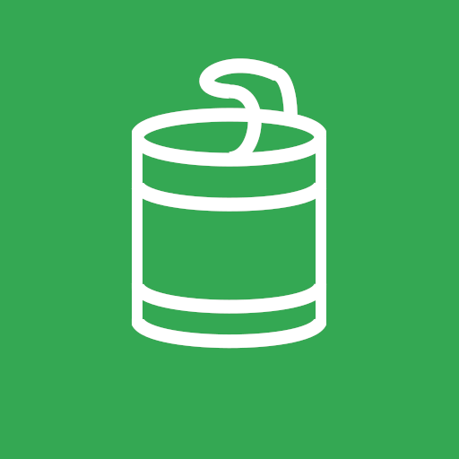

<p align="center">
  
</p>

<h1 align="center">Padegachi</h1>

<p align="center">
  Keep track of what's in your kitchen, and get a nudge before it goes off.
</p>

---

Padegachi is a native Android app I'm building to cut down on food waste at home. You add what you buy, along with its expiry date, and the app tells you when something is about to expire. The idea came from a very ordinary annoyance: tidying the cupboard and finding cans that went out of date months ago.

Everything stays on your phone. There is no account, no server and no tracking, so nothing you enter ever leaves the device.

<p align="center">
  
</p>

## A quick look

<p align="center">
  
  
  
</p>
<p align="center">
  
  
  
</p>

## What it does today

**Keeping track of your food**
- Add, edit and delete items, with a name, brand, category, quantity, purchase date, expiry date and a free comment.
- Point the camera at the printed date and let the app read it for you (on-device text recognition), instead of typing it in.
- Each category has its own illustration, so the list is easy to scan.

**Seeing what needs attention**
- Every item is colour-coded: expired, expiring soon, or fine.
- Filter the list by status, and search by name, brand or category.

**Being reminded**
- A notification warns you a few days before something expires. You choose how many days in the settings, and you can switch reminders off entirely.
- Reminders still arrive when the app is closed.

**Making it yours**
- Light and dark themes.
- Available in French and English.
- A settings screen where you can wipe all your data in one step.

## What's not there yet

I'd rather be upfront about it. These are planned but not built:

- Statistics (how much you've wasted, breakdown by category)
- History of deleted items, with the option to restore them
- Stock handling: decrementing a quantity, duplicating an item with a new date
- More sorting options (by category, alphabetical)
- Recipe suggestions

## How it's built

I use this project to practise modern Android development, so I've tried to keep the structure clean and conventional rather than clever.

| Area | What I used |
| --- | --- |
| Language | Kotlin 2.2.20 |
| UI | Jetpack Compose, Material 3 |
| Dependency injection | Hilt |
| Storage | Room |
| Architecture | MVVM with the Repository pattern |
| Navigation | Navigation Compose, type-safe `@Serializable` routes |
| Camera and OCR | CameraX and ML Kit Text Recognition |
| Reminders | WorkManager |
| Forms | compose-form |
| Async | Kotlin Coroutines and StateFlow |
| Tests | JUnit, in-memory Room, Turbine |
| Build | AGP 8.13.2, KSP |

Minimum supported version is Android 8.0 (API 26).

### Architecture in short

It's a single-activity app with a simple flow of data:

```
Compose UI  ->  ViewModel (StateFlow)  ->  Repository  ->  Room (DAO / entities)
```

- The **data layer** holds the Room entities, DAOs, type converters and a `FoodRepository` with its default implementation.
- **Hilt** wires everything together, including the background worker that sends reminders.
- Each **ViewModel** exposes its screen state as a sealed interface (loading, empty, content). The food list combines several flows, so changing a filter or a search term recomputes the list on its own.
- **Navigation** uses typed routes, and adding and editing share the same screen.
- The expiry status of an item comes from one dedicated class, `FoodStatusCalculator`, so the rule lives in a single place.

### Design

The theme was generated with Material Theme Builder around a blue-teal primary colour (`#1F6E6E`). I chose it deliberately so it wouldn't compete with the red, orange and green used for expiry status. Those status colours live in an extended colour scheme exposed through a `CompositionLocal`, with separate light and dark variants.

## Running it yourself

You'll need Android Studio (recent stable), JDK 17 or newer, and the Android SDK with API 26 or higher.

```bash
git clone <repo-url>
cd padegachi
```

Open the folder in Android Studio, let Gradle sync, and run the `app` configuration on a device or emulator. A physical device is better if you want to try the camera scan.

## Where the project stands

Padegachi is a personal project and still moving. The core is in place: storing food, the list with filters and search, the detail and edit screens, date scanning, reminders and settings. What's left is mostly the extras listed above.

## License

Released under the [GNU General Public License v3.0](LICENSE).
